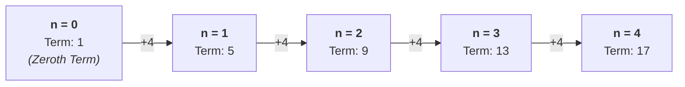

# 1.4 Sequences

## 1.4.1 Introduction to Sequences

A **sequence** is an ordered set of numbers formed according to a specific rule. Each number in the sequence is called a **term**. The position of a term in the sequence is denoted by $n$ (where $n = 1, 2, 3, \dots$). 

* **Term-to-term rule:** Describes how to get from one term to the next (e.g., "add 4").
* **Position-to-term rule ($n$-th term, $T_n$):** A formula that allows you to calculate the value of any term directly using its position $n$, without needing the preceding terms.

---

# 1.4.2 Linear (Arithmetic) Sequences

A **linear sequence** is a chain of numbers where the step size from one term to the next never changes. This fixed step size is called the **common difference**.

---

### Visualizing the Pattern (Concrete & Pictorial)

Let's look at the sequence: **$5, 9, 13, 17, \dots$**

**Block Model Representation**

Imagine building towers of blocks for each position ($n$):

```text
Position (n)      Visual Construction (Core + Growth)           Total Blocks
 ─────────────────────────────────────────────────────────────────────────────
  n = 1            [ 1 Core ] + 1 group of [ 4 ]                  1 + 4 = 5
  n = 2            [ 1 Core ] + 2 groups of [ 4 ][ 4 ]            1 + 8 = 9
  n = 3            [ 1 Core ] + 3 groups of [ 4 ][ 4 ][ 4 ]       1 + 12 = 13
  n = 4            [ 1 Core ] + 4 groups of [ 4 ][ 4 ][ 4 ][ 4 ]  1 + 16 = 17
```

**Number Line & Jump Diagram**



The general formula for the $n$-th term of a linear sequence is:
$$T_n = an + b$$

Where:
* $a$ is the common difference (the jump between terms).
* $b$ is the zeroth term (the value obtained by working backward one step from $n = 1$).

>  **Key Insight:**  
> Every single tower is made of two parts:
> 1. A growing set of **groups of 4** ($4 \times n$)
> 2. A fixed base of **1 extra block** ($+1$)


---

### Worked Example 1.1

Find the $n$-th term of the sequence: 
$$5, 9, 13, 17, \dots$$
Hence, find the 50th term.

**Solution:**
1. **Find the common difference ($a$):**
   $$9 - 5 = 4,\quad 13 - 9 = 4$$
   The common difference is $4$. Therefore, $a = 4$, giving $T_n = 4n + b$.
2. **Find the adjustment ($b$):**
   Substitute $n = 1$ into $4n$:
   $$4(1) = 4$$
   The first term in our sequence is $5$. To get from $4$ to $5$, we must add $1$. Therefore, $b = +1$.
3. **Write the final formula:**
   $$T_n = 4n + 1$$
4. **Calculate the 50th term ($n = 50$):**
   $$T_{50} = 4(50) + 1 = 200 + 1 = 201$$

---

## 1.4.3 Quadratic Sequences

A **quadratic sequence** is a sequence where the second differences between consecutive terms are constant. 

The general formula for the $n$-th term of a quadratic sequence is:
$$T_n = an^2 + bn + c$$

### Method for Finding the Formula:
1. Find the first differences and then the second differences.
2. The coefficient $a$ is always **half of the second difference** ($2a = \text{second difference}$).
3. Subtract the sequence $an^2$ from the original sequence to leave a linear remainder sequence.
4. Find the linear formula ($bn + c$) for that remainder and combine them.

---

### Worked Example 1.2

Find the $n$-th term of the quadratic sequence:
$$5, 10, 17, 26, \dots$$

**Solution:**
1. **Find the differences:**
   * Sequence: $5 \quad 10 \quad 17 \quad 26$
   * 1st differences: $\quad+5 \quad+7 \quad+9$
   * 2nd differences: $\quad\quad+2 \quad+2$
2. **Find $a$:**
   Since the second difference is $2$, we set $2a = 2$, which gives $a = 1$. Our sequence starts with $n^2$.
3. **Subtract $n^2$ from the original sequence:**
   * $n$: $\quad\quad\quad 1 \quad\ \ 2 \quad\ \ 3 \quad\ \ 4$
   * Original ($T_n$): $\ 5 \quad 10 \quad 17 \quad 26$
   * $n^2$: $\quad\quad\quad 1 \quad\ \ 4 \quad\ \ 9 \quad 16$
   * Remainder: $\ 4 \quad\ \ 6 \quad\ \ 8 \quad 10$
4. **Find the linear formula for the remainder ($4, 6, 8, 10$):**
   * Common difference is $2$, so the linear part is $2n$.
   * When $n = 1$, $2(1) = 2$, but we need $4$, so we add $2$. 
   * Remainder formula: $2n + 2$.
5. **Combine into the final formula:**
   $$T_n = n^2 + 2n + 2$$

---

## 1.4.4 Other Common Sequences

* **Geometric (Exponential) Sequences:** Each term is found by multiplying the previous term by a constant multiplier ($r$). 
  * General form: $T_n = a \cdot r^{n-1}$
  * Example: $3, 6, 12, 24, \dots$ ($a = 3, r = 2$)
* **Fibonacci-type Sequences:** Each term is the sum of the two preceding terms.
  * Example: $1, 1, 2, 3, 5, 8, \dots$

---

## Exercise 1.4

1. Find the next two terms and write down the term-to-term rule for each sequence:
   * (a) $7, 13, 19, 25, \dots$
   * (b) $40, 33, 26, 19, \dots$

2. Find the $n$-th term formula for these linear sequences:
   * (a) $6, 10, 14, 18, \dots$
   * (b) $11, 19, 27, 35, \dots$
   * (c) $2, 9, 16, 23, \dots$

3. A pattern of tiles is built using linear growth. Shape 1 uses 7 tiles, Shape 2 uses 11 tiles, and Shape 3 uses 15 tiles.
   * (a) Find an expression for the number of tiles in Shape $n$.
   * (b) Which shape number uses 103 tiles?

4. Find the $n$-th term formula for the quadratic sequences:
   * (a) $4, 9, 16, 25, \dots$
   * (b) $6, 13, 22, 33, \dots$

---

## Answers to Exercise 1.4

1. 
   * (a) $31, 37$; Rule: Add $6$.
   * (b) $12, 5$; Rule: Subtract $7$.

2. 
   * (a) $T_n = 4n + 2$
   * (b) $T_n = 8n + 3$
   * (c) $T_n = 7n - 5$

3. 
   * (a) $T_n = 4n + 3$
   * (b) $4n + 3 = 103 \implies 4n = 100 \implies n = 25$ (Shape 25).

4. 
   * (a) $T_n = n^2 + 2n + 1$ (or $(n+1)^2$)
   * (b) $T_n = n^2 + 4n + 1$
